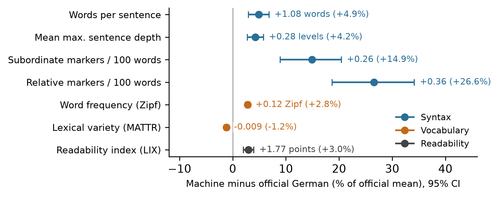

# Translation complexity: main results

Comparison of 259 translation pairs from motions classified as French-authored. Differences are calculated as machine minus official German.

This comparison asks whether the machine translations use simpler vocabulary and sentence structures than the official translations.

## Overall differences

| Measure | Pairs | Difference | 95% confidence interval | Machine higher |
|---|---:|---:|---|---:|
| Words per sentence | 259 | +1.078 | [+0.657, +1.509] | 144 of 259 |
| Mean max. sentence depth | 259 | +0.277 | [+0.182, +0.377] | 159 of 259 |
| Subordinate markers / 100 words | 259 | +0.264 | [+0.158, +0.361] | 161 of 259 |
| Relative markers / 100 words | 259 | +0.355 | [+0.250, +0.457] | 175 of 259 |
| Word frequency (Zipf) | 259 | +0.118 | [+0.100, +0.136] | 200 of 259 |
| Lexical variety (MATTR) | 257 | -0.009 | [-0.012, -0.006] | 97 of 257 |
| Readability index (LIX) | 259 | +1.774 | [+1.199, +2.387] | 161 of 259 |

## Reading the measures

Tree depth is the maximum word depth in each sentence, averaged across sentences within each text. Clause-marker rates count grammatical markers per 100 alphabetic words, rather than complete clauses.

MATTR measures lexical variety in 50-word windows; two pairs are too short for this measure. Higher LIX indicates harder-to-read text.

## Differences by period

The three period columns show mean paired differences within each period; they do not test whether the periods differ.

| Measure | 2000-2008 | 2009-2016 | 2017-2025 |
|---|---:|---:|---:|
| Words per sentence | +1.169 | +1.310 | +0.782 |
| Mean max. sentence depth | +0.284 | +0.342 | +0.212 |
| Subordinate markers / 100 words | +0.298 | +0.228 | +0.262 |
| Relative markers / 100 words | +0.495 | +0.357 | +0.215 |
| Word frequency (Zipf) | +0.149 | +0.121 | +0.083 |
| Lexical variety (MATTR) | -0.012 | -0.009 | -0.006 |
| Readability index (LIX) | +1.975 | +1.350 | +1.953 |

## Relative differences used in the figure

Percentage differences in Zipf scores provide a common plotting scale, not percentage changes in word frequency. Zipf is logarithmic; the ratio below expresses the difference on the frequency scale.

A Zipf difference of +0.118 corresponds to a 1.31-fold geometric mean frequency ratio on the scored scale.

| Measure | % of official mean | 95% confidence interval |
|---|---:|---|
| Words per sentence | +4.9% | [+3.0%, +6.8%] |
| Mean max. sentence depth | +4.2% | [+2.8%, +5.8%] |
| Subordinate markers / 100 words | +14.9% | [+8.9%, +20.4%] |
| Relative markers / 100 words | +26.6% | [+18.7%, +34.2%] |
| Word frequency (Zipf) | +2.8% | [+2.4%, +3.3%] |
| Lexical variety (MATTR) | -1.2% | [-1.6%, -0.8%] |
| Readability index (LIX) | +3.0% | [+2.0%, +4.0%] |

## Additional measures

Measures with no clear evidence of a difference (interval includes zero):

- Mean dependency distance: +0.002 [-0.033, +0.039]
- Lexical density: -0.117 [-0.418, +0.193]

## Method and related results

These intervals estimate sampling uncertainty in the average difference between machine and official German. We resample motion pairs within each year to preserve the sample’s yearly composition. We use 2,000 resamples with seed 47 reset for each measure for reproducibility and take the middle 95% of the resampled mean differences. Author dependence and multiple comparisons are examined separately in the robustness analysis.

See the [detailed results](translation_complexity_details.md) for both versions’ means and the [author-dependence check](complexity_author_dependence.md) for repeated authors.

