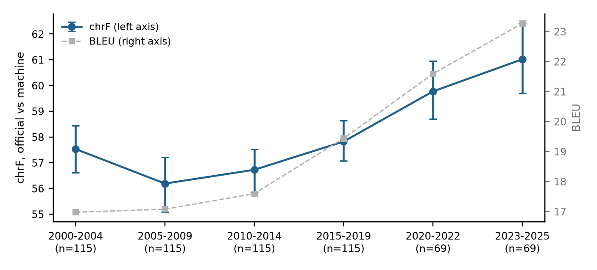

# Similarity of official translations to machine output

French-authored sample, 598 completed pairs. chrF/BLEU: machine vs official German (sacreBLEU, scored separately for each complete document). 95% intervals: 2000 document bootstrap resamples, seed 47.

chrF compares overlapping character sequences; BLEU compares overlapping word sequences. Both are reported on a 0–100 scale, with higher scores indicating greater similarity to the official German wording, not necessarily a better translation.

## Similarity by period

| Period | Texts | Mean chrF | 95% confidence interval | Mean BLEU |
|---|---:|---:|---|---:|
| 2000-2004 | 115 | 57.5 | [56.6, 58.4] | 17.0 |
| 2005-2009 | 115 | 56.2 | [55.1, 57.2] | 17.1 |
| 2010-2014 | 115 | 56.7 | [55.9, 57.5] | 17.6 |
| 2015-2019 | 115 | 57.8 | [57.1, 58.6] | 19.4 |
| 2020-2022 | 69 | 59.8 | [58.7, 61.0] | 21.6 |
| 2023-2025 | 69 | 61.0 | [59.7, 62.4] | 23.3 |

## Trend over time

Linear trend: +1.60 chrF per decade, 95% CI [+1.03, +2.17].

## Interpretation

Increasing similarity is consistent with official translations increasingly being produced from MT output. However, the same pattern could arise if the model had seen recent official translations during training; our data cannot separate these explanations.

See the [source-adjusted analysis](source_adjusted_similarity.md) for a check accounting for changes in the French inputs. Document scores are in [translation_similarity.csv](translation_similarity.csv).

