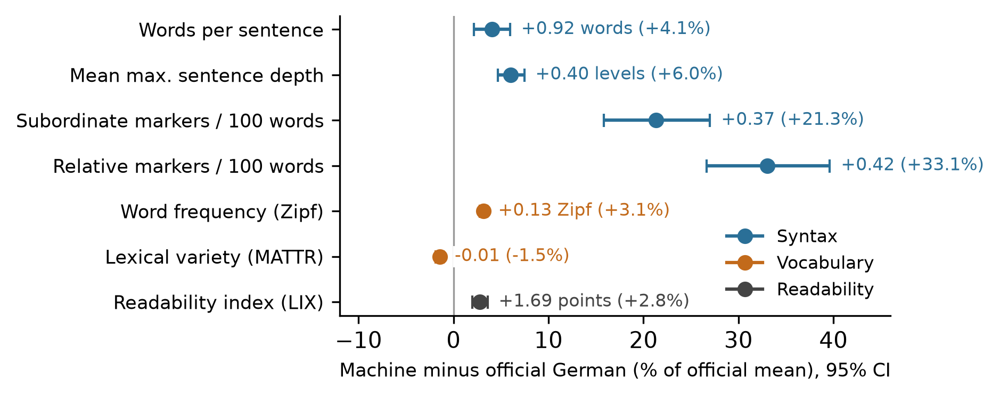

# Translation complexity: main results

Comparison of 338 translation pairs from motions classified as French-authored. Differences are calculated as machine minus official German.

This comparison asks whether the machine translations use simpler vocabulary and sentence structures than the official translations.

## Overall differences

| Measure | Pairs | Difference | 95% confidence interval | Machine higher |
|---|---:|---:|---|---:|
| Words per sentence | 338 | +0.918 | [+0.487, +1.347] | 196 of 338 |
| Mean max. sentence depth | 338 | +0.396 | [+0.306, +0.490] | 228 of 338 |
| Subordinate markers / 100 words | 338 | +0.371 | [+0.276, +0.471] | 215 of 338 |
| Relative markers / 100 words | 338 | +0.418 | [+0.336, +0.500] | 226 of 338 |
| Word frequency (Zipf) | 338 | +0.129 | [+0.113, +0.146] | 272 of 338 |
| Lexical variety (MATTR) | 334 | -0.011 | [-0.015, -0.008] | 114 of 334 |
| Readability index (LIX) | 338 | +1.692 | [+1.199, +2.182] | 221 of 338 |

## Reading the measures

Tree depth is the maximum word depth in each sentence, averaged across sentences within each text. Clause-marker rates count grammatical markers per 100 alphabetic words, rather than complete clauses.

MATTR measures lexical variety in 50-word windows; 4 pairs are too short for this measure. Higher LIX indicates harder-to-read text.

## Differences by period

The three period columns show mean paired differences within each period; they do not test whether the periods differ.

| Measure | 2000-2008 | 2009-2016 | 2017-2025 |
|---|---:|---:|---:|
| Words per sentence | +1.050 | +1.334 | +0.417 |
| Mean max. sentence depth | +0.448 | +0.432 | +0.313 |
| Subordinate markers / 100 words | +0.486 | +0.528 | +0.118 |
| Relative markers / 100 words | +0.463 | +0.425 | +0.366 |
| Word frequency (Zipf) | +0.139 | +0.122 | +0.127 |
| Lexical variety (MATTR) | -0.015 | -0.006 | -0.012 |
| Readability index (LIX) | +1.667 | +2.302 | +1.175 |

## Relative differences used in the figure

Percentage differences in Zipf scores provide a common plotting scale, not percentage changes in word frequency. Zipf is logarithmic; the ratio below expresses the difference on the frequency scale.

A Zipf difference of +0.129 corresponds to a 1.35-fold geometric mean frequency ratio on the scored scale.

| Measure | % of official mean | 95% confidence interval |
|---|---:|---|
| Words per sentence | +4.1% | [+2.2%, +6.0%] |
| Mean max. sentence depth | +6.0% | [+4.6%, +7.4%] |
| Subordinate markers / 100 words | +21.3% | [+15.8%, +27.0%] |
| Relative markers / 100 words | +33.1% | [+26.6%, +39.6%] |
| Word frequency (Zipf) | +3.1% | [+2.7%, +3.5%] |
| Lexical variety (MATTR) | -1.5% | [-1.9%, -1.0%] |
| Readability index (LIX) | +2.8% | [+2.0%, +3.6%] |

## Additional measures

Additional comparisons; an interval including zero indicates no clear evidence of a difference:

- Mean dependency distance: -0.018 [-0.052, +0.015]
- Lexical density: -0.257 [-0.538, +0.017]

## Method and related results

These intervals estimate sampling uncertainty in the average difference between machine and official German. We resample motion pairs within each year to preserve the sample’s yearly composition. We use 2,000 resamples with seed 47 reset for each measure for reproducibility and take the middle 95% of the resampled mean differences. Author-adjusted mixed models and multiple-comparison correction have not been repeated for this sample.

See the [detailed results](translation_complexity_details.md) for both versions’ means. Author-adjusted mixed models and multiple-comparison correction have not been repeated for this sample.

