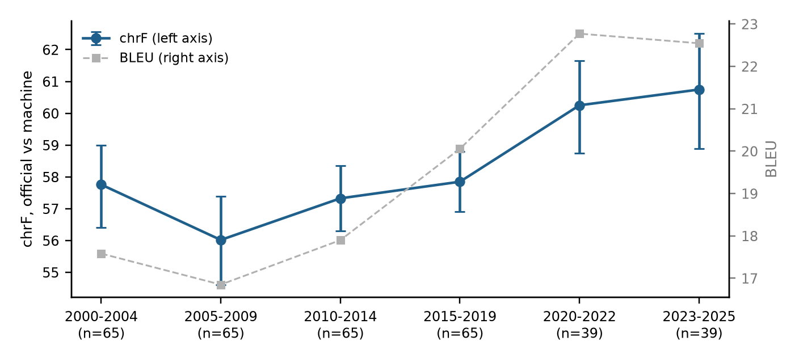

# Similarity of official translations to machine output

French-authored sample, 338 completed pairs. chrF/BLEU: machine vs official German (sacreBLEU, scored separately for each complete document). 95% intervals: 2000 document bootstrap resamples, seed 47.

chrF compares overlapping character sequences; BLEU compares overlapping word sequences. Both are reported on a 0–100 scale, with higher scores indicating greater similarity to the official German wording, not necessarily a better translation.

## Similarity by period

| Period | Texts | Mean chrF | 95% confidence interval | Mean BLEU |
|---|---:|---:|---|---:|
| 2000-2004 | 65 | 57.8 | [56.4, 59.0] | 17.6 |
| 2005-2009 | 65 | 56.0 | [54.6, 57.4] | 16.9 |
| 2010-2014 | 65 | 57.3 | [56.3, 58.4] | 17.9 |
| 2015-2019 | 65 | 57.8 | [56.9, 58.8] | 20.1 |
| 2020-2022 | 39 | 60.3 | [58.7, 61.7] | 22.8 |
| 2023-2025 | 39 | 60.7 | [58.9, 62.5] | 22.5 |

## Trend over time

Linear trend: +1.58 chrF per decade, 95% CI [+0.83, +2.35].

## Interpretation

Increasing similarity is consistent with official translations increasingly being produced from MT output. However, the same pattern could arise if the model had seen recent official translations during training; our data cannot separate these explanations.

See the [source-adjusted analysis](source_adjusted_similarity.md) for a check accounting for changes in the French inputs. Document scores are in [translation_similarity.csv](translation_similarity.csv).

